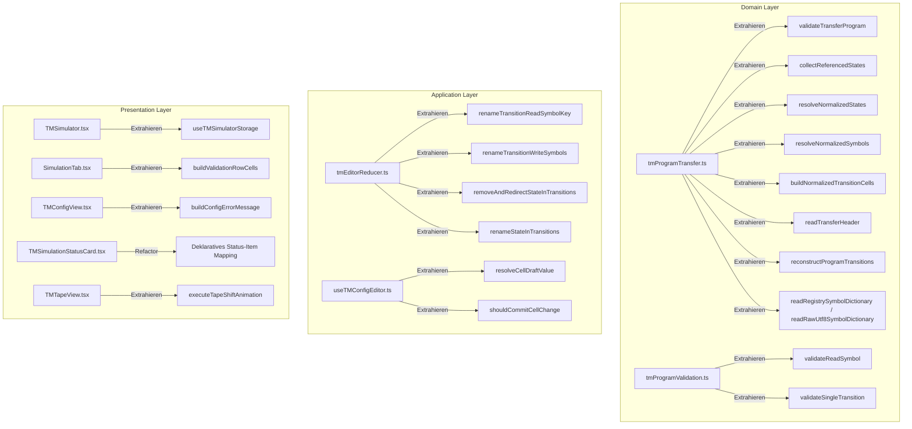

# Turingmaschine: Refactoring- & Vereinfachungskonzept

Dieses Dokument beschreibt das detaillierte Konzept zur Reduktion von Komplexität, Behebung der `fallow-filter`-Befunde und Steigerung der Wartbarkeit und Lesbarkeit des Turingmaschinen-Moduls unter `src/pages/FundamentalsCS/TuringMachine/`.

> [!IMPORTANT]
> **Zusicherung der Funktionalität, Test- und Build-Integrität:**
> - Der vollständige Produktions-Build (`npm run build` bzw. `tsc -b && vite build`) muss **fehlerfrei durchlaufen**.
> - Alle bestehenden 150 Unit-Tests (`tests/unit_tests/FundamentalsCS/Turingmachine/*.test.{ts,tsx}`) und E2E-Tests (`tests/e2e/turing-machine.spec.ts`) bleiben **unverändert** und müssen zu 100% erfolgreich durchlaufen.
> - Alle öffentlichen Signaturen, Schnittstellen, DOM `data-testid`-Attribute und Bitstream-Transfer-Codecs bleiben strikt abwärtskompatibel.

---

## 1. Übersicht & Analyse der Fallow-Filter-Befunde

### 1.1 Bewusste Ausnahmen (Nicht refactoren)

1. **Dead Code: `TuringMachinePage.tsx:7` (`export function TuringMachinePage`)**
   - **Status:** **Wird beibehalten (Keine Änderung)**
   - **Begründung:** Fallow-False-Positive. Der Named Export wird für den Build und das dynamische Modul-Routing im App-Shell zwingend benötigt.

2. **Code Duplication: `ExamplesTab.tsx:43-54`**
   - **Status:** **Wird beibehalten (Keine Änderung)**
   - **Begründung:** Die Struktur wird für anstehende fachliche Erweiterungen und Anpassungen an den Beispielen in dieser Form benötigt.

---

### 1.2 Zu behebende Code Health & Complexity Findings (15 Befunde)

| Datei & Funktion / Stelle | Aktuelle Metriken | Kernproblem & Ursache |
| :--- | :--- | :--- |
| `tmProgramTransfer.ts:106` in `normalizeProgram` | Cognitive: 19, Cyclo: 17, Lines: 98 | Bündelt Validierung, Graph-Analyse, Alphabet-Normalisierung & Bit-Matrix in einer monolithischen Funktion |
| `TMSimulator.tsx:49` in `TMSimulator` | CRAP: 90, Lines: 210 | Koordiniert Imperative Handle, Speicher-Synchronisation, Validierungsauflösung und Modus-Umschaltung |
| `SimulationTab.tsx:13` in `SimulationTab` | CRAP: 90, Lines: 140 | Vermischt Szenario-Resolution, Lösungsprüfung, Header-Actions und Tabellenzeilen-Transformation |
| `tmProgramTransfer.ts:422` in `restoreImportedProgram` | Cognitive: 15, Cyclo: 12, Lines: 100 | Monolithische Deserialisierung von Headern, Bitmasken, Wörterbüchern und 2D-Übergangsgittern |
| `tmProgramTransfer.ts:529` in `readSymbolDictionary` | Cognitive: 15, Cyclo: 10, Lines: 50 | Vermischung von Registry-Bitmasken-Dekodierung und variabler UTF-8-Bytedekodierung |
| `tmProgramValidation.ts:128` in `validateTransitions` | Cognitive: 23, Cyclo: 11, Lines: 76 | Tief verschachtelte Schleifen (`readSymbol` × `state`) mit 5 verschiedenen Validierungsregeln |
| `tmEditorReducer.ts:153` in `renameTapeSymbol` | Cognitive: 15, Cyclo: 12, Lines: 49 | Inline-Mutationen für Alphabete, Band, Leerzeichen, Übergangsschlüssel und Schreibsymbole |
| `tmEditorReducer.ts:210` in `removeState` | Cognitive: 16, Cyclo: 11, Lines: 46 | Sucht Fallback-Zustand, löscht Quellzustand und biegt Zielzustände in verschachtelten Schleifen um |
| `tmEditorReducer.ts:257` in `renameState` | Cognitive: 17, Cyclo: 12, Lines: 52 | Benennt Zustandslisten, Initialzustand, Übergangs-Quellschlüssel und Übergangs-Zielzustände um |
| `useTMConfigEditor.ts:176` in `handleCellBlur` | Cognitive: 6, Cyclo: 10, Lines: 45 | Verschachtelte Fallunterscheidungen für Entwurfswert, Validierung, Dispatch und State-Bereinigung |
| `TMTapeView.tsx:274` in LayoutEffect (`<arrow>`) | Cognitive: 9, Cyclo: 10, Lines: 75 | Verschachtelte Animation-Guards, DOM-Offset-Messung und zweistufige `requestAnimationFrame`-Steuerung |
| `TMSimulationStatusCard.tsx:13` in `TMSimulationStatusCard` | CRAP: 42, Lines: 78 | Redundantes JSX-Layout für Statuszeilen und Haltegrund-Formatierung |
| `SimulationTab.tsx:90` in `resultRows` | Cognitive: 5, Cyclo: 6, Lines: 17 | Verschachtelte ternäre Operatoren für Pass/Fail, Leerwörter (`ε`) und Haltezustand |
| `SimulationTab.tsx:43` in `handleCheckSolution` | Cognitive: 2, Cyclo: 5, Lines: 19 | Mehrfache Wächterbedingungen vor asynchroner Ausführung |
| `TMConfigView.tsx:22` in `TMConfigView` | CRAP: 30, Lines: 111 | Inline-Fehlerzusammenstellung, String-Verkettung und Alert-Prüfungen |

---

## 2. Detaillierter Refactoring-Plan nach Schichten und Dateien

### 2.1 Domain Layer

#### `components/Simulator/domain/tmProgramTransfer.ts`
- **Aktueller Zustand**:
  - `normalizeProgram` (98 Zeilen, Komplexität 19) führt Validierung, Graph-Knoten-Berechnung, Alphabet-Sortierung und 2D-Matrix-Flattening sequentiell aus.
  - `restoreImportedProgram` (100 Zeilen, Komplexität 15) führt die vollständige Bitstream-Rekonstruktion in einer Funktion aus.
  - `readSymbolDictionary` (50 Zeilen, Komplexität 15) behandelt Registry- und UTF-8-Modus zusammen.
- **Zielarchitektur & Auslagerungen**:
  1. `validateTransferProgram(program: TMProgram): void`  
     Kapselt alle Vorbedingungen (Gültigkeit, Blank-Symbol-Präsenz, doppelte Zustände, Disjunktheit).
  2. `collectReferencedStates(transitions: TMProgram["transitions"], haltStates: Set<string>): { sourceStates: Set<string>; targetedStates: Set<string> }`  
     Ermittelt reine Quell- und Zielzustände aus der Übergangstabelle.
  3. `resolveNormalizedStates(program: TMProgram, sourceStates: Set<string>, targetedStates: Set<string>): { nonHaltStates: string[]; usedHaltStates: string[]; stateIds: Map<string, number> }`  
     Erzeugt die kanonische Zustandsreihenfolge und die ID-Zuordnung.
  4. `resolveNormalizedSymbols(program: TMProgram, readableSymbols: string[], nonHaltStates: string[]): { symbols: string[]; symbolIds: Map<string, number>; readableSymbolIds: number[] }`  
     Ermittelt das verwendete Alphabet, bestimmt Registry/Raw-Modus und generiert Symbol-IDs.
  5. `buildNormalizedTransitionCells(...)`  
     Erzeugt das flache 2D-Übergangsraster für die Bitstream-Serialisierung.
  6. `readTransferHeader(reader: BitReader): { nonHaltStateCount: number; haltStateCount: number; symbolCount: number; initialTapeLength: number; totalStateCount: number }`  
     Liest und validiert alle Header-Felder inklusive Sammlungsgrößen-Limits.
  7. `readReadableSymbolIds(reader: BitReader, symbolCount: number): number[]`  
     Liest die Bitmaske für lesbare Symbole.
  8. `reconstructProgramTransitions(...)`  
     Wandelt das flache Zellenarray in das geschachtelte `TMProgram["transitions"]`-Objekt um.
  9. `readRegistrySymbolDictionary` & `readRawUtf8SymbolDictionary`  
     Trennt die beiden Dekodierungsarten sauber auf.

#### `components/Simulator/domain/tmProgramValidation.ts`
- **Aktueller Zustand**:
  - `validateTransitions` (76 Zeilen, Kognitive Komplexität: 23) enthält tief verschachtelte Schleifen mit vielen Validierungsregeln.
- **Zielarchitektur & Auslagerungen**:
  1. `validateReadSymbol(readSymbol: string, tapeAlphabet: Set<string>, issues: TMProgramIssue[]): void`  
     Prüft, ob das gelesene Bandsymbol im Bandalphabet existiert und ein Einzelzeichen ist (`transition_read_symbol_missing`, `transition_read_symbol_invalid`).
  2. `validateSingleTransition(readSymbol: string, state: string, transition: TMTransition, states: Set<string>, tapeAlphabet: Set<string>, issues: TMProgramIssue[]): void`  
     Prüft Ausgangszustand, Folgezustand, Schreibsymbol-Präsenz und Einzelzeichenformat.
  3. `validateTransitions`: Flache Iteration über `program.transitions`, delegiert an die beiden Hilfsfunktionen.

---

### 2.2 Application Layer

#### `components/Simulator/application/tmEditorReducer.ts`
- **Aktueller Zustand**:
  - `renameTapeSymbol`, `removeState` und `renameState` enthalten wiederholte Traversierungs- und Umschreibemuster auf der Übergangstabelle.
- **Zielarchitektur & Auslagerungen**:
  1. `renameTransitionReadSymbolKey(transitions: TransitionTable, currentSymbol: TapeSymbol, nextSymbol: TapeSymbol): void`  
     Verschiebt den äußeren Tabellenschlüssel `transitions[currentSymbol]` nach `transitions[nextSymbol]`.
  2. `renameTransitionWriteSymbols(transitions: TransitionTable, currentSymbol: TapeSymbol, nextSymbol: TapeSymbol): void`  
     Ersetzt in allen Übergängen `writeSymbol === currentSymbol` durch `nextSymbol`.
  3. `removeAndRedirectStateInTransitions(transitions: TransitionTable, stateToRemove: StateName, fallbackState: StateName): void`  
     Löscht alle von `stateToRemove` ausgehenden Übergänge und biegt Folgezustände (`nextState === stateToRemove`) auf `fallbackState` um.
  4. `renameStateInTransitions(transitions: TransitionTable, currentState: StateName, nextState: StateName): void`  
     Benennt den Quellzustandsschlüssel um und aktualisiert alle Zielreferenzen (`nextState === currentState`).

#### `components/Simulator/application/useTMConfigEditor.ts`
- **Aktueller Zustand**:
  - `handleCellBlur` bündelt Draft-Auflösung, Validierung, Dispatch und Issue-Bereinigung in einem großen Block.
- **Zielarchitektur & Auslagerungen**:
  1. `resolveCellDraftValue(cellDrafts: Record<string, string>, committedRows: string[][], rowIndex: number, colIndex: number): string`  
     Ermittelt den aktuellen Wert.
  2. `shouldCommitCellChange(draftValue: string, committedValue: string | undefined): boolean`  
     Prüft, ob der Wert modifiziert wurde.
  3. Verschlankung von `handleCellBlur` in einen linearen Ablauf ohne verschachtelte Verzweigungen.

#### `components/Simulator/application/tmSolutionChecker.ts`
- **Zielarchitektur**:
  - `serializeTapeOutput` wird durch kompakte Index-Ermittlung und Filterung vereinfacht.

---

### 2.3 Presentation Layer

#### `components/Simulator/TMSimulator.tsx`
- **Aktueller Zustand**:
  - CRAP: 90, 210 Zeilen. Bündelt imperativen Handle, Storage-Auto-Save, Active-Simulator-Transfer und View-Rendering.
- **Zielarchitektur & Auslagerungen**:
  1. `useTMSimulatorStorage`: Kapselt Storage-Identifikatoren, Laden, Auto-Save und Active-Simulator-Transfer in einen dedizierten Hook oder Hilfsblock.
  2. `TMSimulator`: Konzentriert sich rein auf Modusumschaltung (Edit vs. Simulation) und das Bereitstellen des `TMSimulatorHandle`.

#### `components/SimulationTab.tsx`
- **Aktueller Zustand**:
  - CRAP: 90, `resultRows` mit verschachtelten ternären Operatoren.
- **Zielarchitektur & Auslagerungen**:
  1. `buildValidationRowCells(row: TMValidationResultRow, t: TFunction): string[]`  
     Formatiert Status, Eingabe, Ausgabe, erwartete Ausgabe und Haltezustand übersichtlich mit Leerwort-Fallback (`ε`).
  2. `SimulationTab`: Verwendet `buildValidationRowCells` im `resultRows`-Memo und hält Wächterklauseln kompakt.

#### `components/Simulator/presentation/TMConfigView.tsx`
- **Zielarchitektur & Auslagerungen**:
  1. `buildConfigErrorMessage(validationIssues: TMProgramIssue[], blockingCellIssue: TMEditorCellIssue | null, t: TFunction): string`  
     Kapselt die Übersetzung und Formatierung aller Validierungs- und Zellfehler.
  2. `TMConfigView`: Konzentriert sich rein auf die Darstellung der Komponenten-Sektionen.

#### `components/Simulator/presentation/TMSimulationStatusCard.tsx`
- **Zielarchitektur**:
  - Definition eines deklarativen `statusItems`-Arrays zur Vermeidung redundanter Grid-Spalten im JSX.

#### `components/Simulator/presentation/TMTapeView.tsx`
- **Zielarchitektur & Auslagerungen**:
  1. `executeTapeShiftAnimation`: Extrahiert die DOM-Transformation und das `requestAnimationFrame`-Scheduling aus dem `useLayoutEffect`.

---

## 3. Architektur-Übersicht

---

## 4. Verifikations-Checkliste

- [ ] **Produktions-Build:** `npm run build` (TypeScript-Kompilierung & Vite-Bundle) läuft ohne Fehler durch.
- [ ] **Unit-Tests:** `npm test -- tests/unit_tests/FundamentalsCS/Turingmachine` läuft fehlerfrei durch (alle 150 Tests grün).
- [ ] **E2E-Tests:** Alle E2E-Workflows (`npm run test:e2e -- turing-machine.spec.ts`) laufen fehlerfrei durch.
- [ ] **Fallow-Filter:** `node scripts/fallow-filter.mjs --tm` zeigt **0** `CODE HEALTH & COMPLEXITY FINDINGS` im TM-Ordner an.
- [ ] **Abwärtskompatibilität:** Exportierte Schnittstellen und Datentypen sind 100% abwärtskompatibel.
