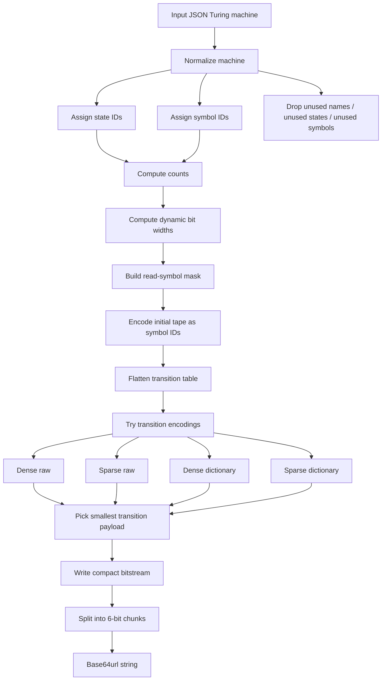
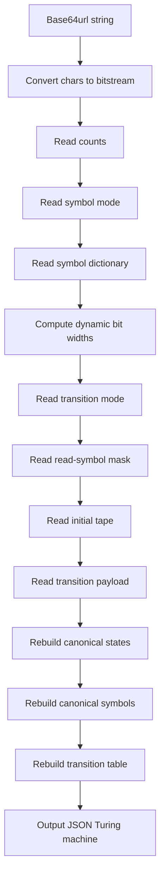
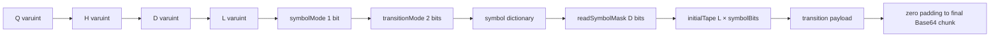
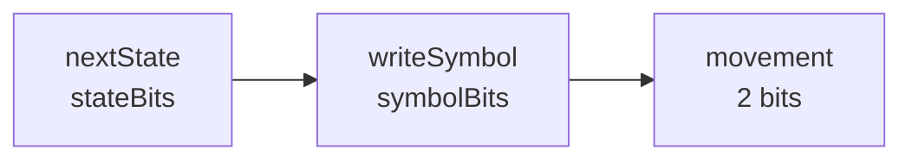

# Encoding process



---

# Decoding process



---

# Compact bitstream layout



Fields:

```txt
Q = number of non-halting states
H = number of halt states
D = number of tape symbols
L = initial tape length
```

State IDs:

```txt
0 ... Q-1       = non-halting states
Q ... Q+H-1     = halt states
```

The initial state is always state `0`.

Symbol IDs:

```txt
0 = DEFAULT_BLANK_SYMBOL
1 ... D-1 = other tape symbols
```

---

# Dynamic bit widths

After reading the counts, compute:

```txt
totalStates = Q + H

stateBits  = bitsNeeded(totalStates)
symbolBits = bitsNeeded(D)
moveBits   = 2
```

Use:

```txt
bitsNeeded(count):
  if count <= 1: return 0
  else: return ceil(log2(count))
```

Equivalent integer formula:

```txt
bitsNeeded(count) = count <= 1 ? 0 : floor(log2(count - 1)) + 1
```

Examples:

```txt
1 value      -> 0 bits
2 values     -> 1 bit
3-4 values   -> 2 bits
5-8 values   -> 3 bits
9-16 values  -> 4 bits
17-32 values -> 5 bits
```

For your example:

```txt
Q = 3
H = 1
D = 4
L = 4

totalStates = 4
stateBits   = 2
symbolBits  = 2
moveBits    = 2
```

Each transition therefore costs:

```txt
nextState   2 bits
writeSymbol 2 bits
movement    2 bits
total       6 bits
```

---

# Varuint encoding

Use a simple unsigned 7-bit varuint.

Each emitted byte contains:

```txt
high bit   = continuation flag
low 7 bits = data
```

Meaning:

```txt
0xxxxxxx = final byte
1xxxxxxx = another byte follows
```

Small numbers like `3`, `4`, `17`, or `127` take exactly one byte.

Use varuint for:

```txt
Q
H
D
L
dictionary size K
raw symbol byte lengths
```

---

# Base64url encoding

Use this alphabet:

```txt
ABCDEFGHIJKLMNOPQRSTUVWXYZabcdefghijklmnopqrstuvwxyz0123456789-_
```

Encoding:

```txt
bitstream -> groups of 6 bits -> Base64url chars
```

No `=` padding.

If the final group has fewer than 6 bits, pad it with zero bits.
During decoding, read only the fields required by the format and ignore leftover trailing zero bits.

---

# Movement encoding

```txt
0 = L
1 = R
2 = N
3 = invalid / reserved
```

Movement always uses exactly 2 bits.

---

# Symbol encoding

Use one symbol mode bit:

```txt
symbolMode = 0 -> registry symbols
symbolMode = 1 -> raw UTF-8 symbols
```

The blank symbol is never stored in the dictionary.

It is always:

```txt
symbol ID 0 = DEFAULT_BLANK_SYMBOL
```

## Symbol mode 0: registry

Use a fixed built-in registry in the app.

Example:

```txt
registry index 0  = "0"
registry index 1  = "1"
registry index 2  = "E"
registry index 3  = "X"
registry index 4  = "Y"
registry index 5  = "A"
registry index 6  = "B"
registry index 7  = "C"
registry index 8  = "D"
registry index 9  = "#"
registry index 10 = "$"
registry index 11 = "|"
registry index 12 = "a"
registry index 13 = "b"
registry index 14 = "c"
registry index 15 = "d"
```

Store a fixed-size registry mask, for example 16 bits.

For your example:

```txt
needed symbols:
blank, "0", "1", "E"

blank is implicit.

registry mask:
"0" -> 1
"1" -> 1
"E" -> 1
others -> 0
```

So the non-blank symbols become:

```txt
symbol ID 1 = "0"
symbol ID 2 = "1"
symbol ID 3 = "E"
```

The decoder should verify:

```txt
D === 1 + popcount(registryMask)
```

## Symbol mode 1: raw UTF-8

Use this if at least one non-blank symbol is not in the registry.

Store exactly `D - 1` symbols.

For each symbol:

```txt
byteLength: varuint
UTF-8 bytes: byteLength × 8 bits
```

Decoded symbols become:

```txt
symbol ID 0 = DEFAULT_BLANK_SYMBOL
symbol ID 1 = first stored symbol
symbol ID 2 = second stored symbol
...
```

---

# Read-symbol mask

After the symbol dictionary, store:

```txt
readSymbolMask: D bits
```

One bit per tape symbol ID.

```txt
1 = this symbol has a transition row
0 = this symbol has no transition row
```

Bits are written in ascending symbol ID order:

```txt
symbol 0, symbol 1, symbol 2, ...
```

For your example:

```txt
symbol ID 0 = blank
symbol ID 1 = "0"
symbol ID 2 = "1"
symbol ID 3 = "E"
```

Only blank, `0`, and `1` have transition rows:

```txt
readSymbolMask = 1110
```

Then:

```txt
readRowCount = popcount(readSymbolMask)
```

---

# Initial tape encoding

The initial tape is encoded as symbol IDs.

```txt
initialTape:
  L entries
  each entry uses symbolBits bits
```

For your example:

```txt
initial tape = 1001

symbol IDs:
"1" -> 2
"0" -> 1

encoded tape:
[2, 1, 1, 2]
```

Since `symbolBits = 2`, this costs:

```txt
4 × 2 = 8 bits
```

---

# Transition triple encoding

Every transition is encoded as:

```txt
nextState
writeSymbol
movement
```

With dynamic widths:

```txt
nextState   uses stateBits bits
writeSymbol uses symbolBits bits
movement    uses 2 bits
```

Layout:



A transition triple is valid only if:

```txt
0 <= nextState < Q + H
0 <= writeSymbol < D
movement is 0, 1, or 2
```

---

# Transition cell order

Always flatten transition cells in this deterministic order:

```txt
for each readable symbol ID in ascending order:
  for each non-halting state ID from 0 to Q - 1:
    encode the cell
```

Halt states never have transition columns.

For your example:

```txt
read rows:
blank, 0, 1

non-halting states:
q0, q1, q2
```

Cell order:

```txt
blank/q0
blank/q1
blank/q2
0/q0
0/q1
0/q2
1/q0
1/q1
1/q2
```

---

# Transition modes

Use 2 bits:

```txt
transitionMode = 0 -> dense raw
transitionMode = 1 -> sparse raw
transitionMode = 2 -> dense dictionary
transitionMode = 3 -> sparse dictionary
```

The encoder should try all valid modes and choose the smallest one.

Let:

```txt
possibleCells = readRowCount × Q
tripleBits    = stateBits + symbolBits + 2
T             = number of existing transitions
K             = number of unique transition triples
dictBits      = bitsNeeded(K)
```

---

## Mode 0: dense raw

Use this when every possible cell has a transition.

Payload:

```txt
possibleCells × transitionTriple
```

Size:

```txt
possibleCells × tripleBits
```

No transition count is stored.

---

## Mode 1: sparse raw

Use this when some cells are empty.

For every possible cell:

```txt
presence bit:
  0 = no transition
  1 = transition follows
```

If present, immediately write one transition triple.

Size:

```txt
possibleCells + T × tripleBits
```

No transition count is stored.

---

## Mode 2: dense dictionary

Use this when every possible cell has a transition and many transitions repeat.

Payload:

```txt
K: varuint
K transition triples
possibleCells dictionary indexes
```

Dictionary indexes use:

```txt
dictBits = bitsNeeded(K)
```

Size:

```txt
varuint(K) + K × tripleBits + possibleCells × dictBits
```

The dictionary order should be deterministic. Use first occurrence order while scanning cells.

---

## Mode 3: sparse dictionary

Use this when some cells are empty and many existing transitions repeat.

Payload:

```txt
K: varuint
K transition triples

for each possible cell:
  presence bit
  if present:
    dictionary index
```

Size:

```txt
varuint(K) + K × tripleBits + possibleCells + T × dictBits
```

---

# Normalization rules

The compact string stores behavior, not UI names.

## State normalization

Original state names are not stored.

Recommended encoder rule:

```txt
1. State ID 0 is always the initial state.
2. Other non-halting states get IDs 1 ... Q-1.
3. Halt states get IDs Q ... Q+H-1.
4. Discard unused states that are neither initial, source states, nor transition targets.
5. Discard unused halt states that are never targeted.
```

Decoder-generated names:

```txt
non-halting:
0 -> q0
1 -> q1
2 -> q2
...

halt:
if H === 1:
  Q -> qS
else:
  Q     -> qH0
  Q + 1 -> qH1
  ...
```

## Symbol normalization

```txt
symbol ID 0 = DEFAULT_BLANK_SYMBOL
```

All other symbols are assigned according to the chosen symbol mode.

Unused tape alphabet symbols are discarded.

---

# Decoded JSON shape

The decoder should rebuild this structure:

```txt
{
  states: [...canonical state names],
  tapeAlphabet: [...decoded symbols],
  blankSymbol: DEFAULT_BLANK_SYMBOL,
  initialState: "q0",
  haltStates: [...canonical halt state names],
  initialTape: [...decoded tape symbols],
  transitions: {
    [readSymbol]: {
      [stateName]: {
        nextState,
        writeSymbol,
        movement
      }
    }
  }
}
```

The decoded machine may not have the same original state names, but it should behave the same.

For your example, `qS` may decode back as `qS` because there is exactly one halt state. If there are multiple halt states, use `qH0`, `qH1`, etc.

---

# Example summary for your machine

```txt
Q = 3
H = 1
D = 4
L = 4

stateBits  = 2
symbolBits = 2
tripleBits = 6

readSymbolMask = 1110
readRowCount   = 3

possibleCells = 3 × 3 = 9
```

Dense raw transition size:

```txt
9 × 6 = 54 bits
```

Sparse raw transition size:

```txt
9 presence bits + 9 × 6 bits = 63 bits
```

So for your example, the encoder should choose:

```txt
transitionMode = 0
dense raw
```

Final pipeline:

```txt
JSON
-> normalize
-> numeric IDs
-> compact bitstream
-> Base64url
```
