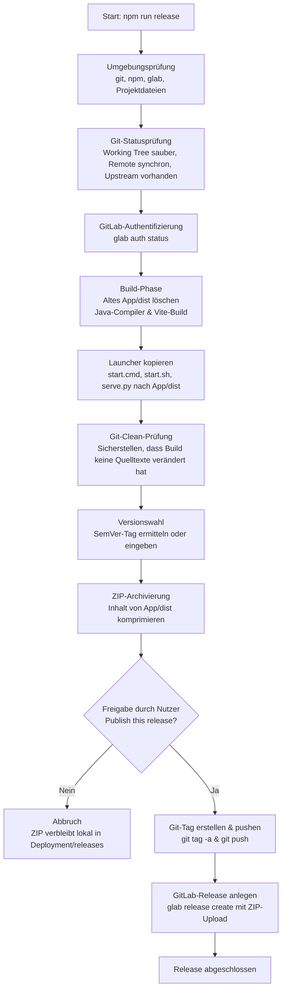

# Deployment und Release-Prozess

Dieses Verzeichnis enthält die Werkzeuge zur Erstellung, Paketierung und Veröffentlichung portabler Releases der Plattform sowie die Launcher-Skripte für den lokalen Offline-Betrieb.

---

## 1. Ablaufdiagramm



---

## 2. Komponenten und Dateien

| Datei / Ordner | Funktion |
| :--- | :--- |
| `create-release.mjs` | Node.js-Skript zur Automatisierung von Prüfung, Build, Tagging, Paketierung und GitLab-Upload. |
| `serve.py` | Python-3-HTTP-Server für den Offline-Betrieb. Behandelt SPA-Routing (`/index.html`-Fallback) und liefert WebAssembly mit dem MIME-Type `application/wasm` aus. |
| `start.cmd` | Windows-Batch-Starter. Sucht eine lokale Python-Installation und ruft `serve.py` auf. |
| `start.sh` | Shell-Skript für Linux und macOS. Setzt POSIX-Ausführungsrechte und ruft `serve.py` auf. |
| `releases/` | Lokales Zielverzeichnis für erzeugte ZIP-Dateien (`GI-TrainingCenter-vX.Y.Z.zip`). |

---

## 3. Voraussetzungen

Für die Ausführung des Release-Skripts müssen folgende Werkzeuge auf dem System installiert und im Pfad verfügbar sein:

- **Node.js** (mindestens Version 22.12.0) und **npm**
- **Git** (konfiguriertes lokales Repository mit gesetztem Upstream-Remote)
- **GitLab CLI (`glab`)** mit aktivem Login (`glab auth login` / `glab auth status`) und entsprechender Berechtigung

---

## 4. Durchführung eines Releases

Der Befehl wird im Verzeichnis `App` ausgeführt:

```bash
cd App
npm run release
```

Das Skript `Deployment/create-release.mjs` durchläuft dabei folgende Schritte:

### Schritt 1: Prüfung von Umgebung und Git-Repository
1. Validiert das Vorhandensein von `git`, `npm`, `glab` und der Projektstruktur (`App/package.json`, `start.cmd`, `start.sh`, `serve.py`).
2. Prüft den Arbeitsbaum (`git status --porcelain`). Uncommittete Änderungen an getrackten Dateien brechen den Prozess sofort ab (unversionierte / ungetrackte Dateien sind zulässig).
3. Prüft den Git-Branch. Ein Detached HEAD ist unzulässig.
4. Holt den aktuellen Stand vom Remote-Repository (`git fetch origin --tags --prune`).
5. Vergleicht lokalen Commit-Stand mit dem Remote-Branch (`HEAD...@{u}`). Der lokale Stand muss identisch sein (keine ungesendeten Commits, kein Rückstand).
6. Prüft die GitLab-Authentifizierung über `glab auth status`.

### Schritt 2: Build der Anwendung
1. Löscht das Zielverzeichnis `App/dist/` vollständig.
2. Führt `npm run build` im Verzeichnis `App/` aus:
   - `npm run prepare:java-compiler`: Erzeugt die Java-Compiler-WASM-Artefakte.
   - `tsc -b`: TypeScript-Typüberprüfung und Build.
   - `vite build`: Bündelung der React-Anwendung, CSS-Dateien und statischen Assets.
3. Verifiziert, dass `App/dist/` erfolgreich erzeugt wurde.

### Schritt 3: Bereitstellung der Starter-Dateien
1. Kopiert `start.cmd`, `start.sh` und `serve.py` direkt in den Ordner `App/dist/`.
2. Normalisiert in `start.sh` Windows-Zeilenumbrüche (`CRLF` zu `LF`).
3. Setzt unter Linux/Unix Systemen das Ausführungsbit (`chmod 755`) für `start.sh`.
4. Führt eine erneute Git-Statusprüfung durch, um sicherzustellen, dass keine Quellcodedateien versehentlich durch den Build modifiziert wurden.

### Schritt 4: Versionsvergabe
1. Liest alle existierenden Git-Tags nach dem Muster `v*` aus.
2. Ermittelt die höchste Version nach Semantic Versioning (`vMAJOR.MINOR.PATCH`).
3. Berechnet das nächste Patch-Release (z. B. `v1.0.3` -> `v1.0.4`).
4. Erfragt im Terminal die gewünschte Versionsnummer mit dem berechneten Wert als Standard.
5. Prüft, ob der gewählte Tag lokal oder remote bereits existiert.

### Schritt 5: ZIP-Paketierung
1. Erstellt das Verzeichnis `Deployment/releases/`, falls es nicht existiert.
2. Packt den **Inhalt** von `App/dist/` (ohne den übergeordneten Ordnernamen) in `Deployment/releases/GI-TrainingCenter-vX.Y.Z.zip`:
   ```text
   GI-TrainingCenter-vX.Y.Z.zip
   ├── index.html
   ├── assets/
   ├── serve.py
   ├── start.cmd
   └── start.sh
   ```

### Schritt 6: Veröffentlichung
1. Zeigt eine Zusammenfassung mit Branch, Remote, Commit, Version und Zieldatei an.
2. Wartet auf die Bestätigung (`Publish this release? [y/N]`).
   - Bei Eingabe von `N` oder Abbruch bleibt die ZIP-Datei lokal in `Deployment/releases/` gespeichert. Es wird kein Git-Tag angelegt.
   - Bei Eingabe von `y`:
     1. Erstellt einen annotierten Git-Tag (`git tag -a vX.Y.Z -m "GI Training Center vX.Y.Z"`).
     2. Überträgt den Tag auf den GitLab-Server (`git push <remote> vX.Y.Z`).
     3. Erstellt automatisch Release Notes (Git-Branch, Commit-Hash, Referenz zum Vorgänger-Release).
     4. Ruft `glab release create` auf, lädt die ZIP-Datei in die GitLab Package Registry hoch und verknüpft sie mit dem Release.

---

## 5. Lokale Nutzung des Release-Pakets

Endanwender benötigen für den Betrieb keine Node.js-Umgebung:

1. ZIP-Archiv entpacken.
2. Starter ausführen:
   - **Windows:** Doppelklick auf `start.cmd`.
   - **Linux / macOS:** Ausführung von `./start.sh` im Terminal.
3. Das Skript startet `serve.py` auf `http://127.0.0.1:8080` und öffnet die Anwendung im Standard-Webbrowser.
