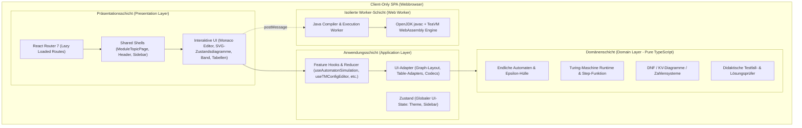

# Architektur & Systementwurf der GI-Lernplattform

Dieses Dokument beschreibt die Softwarearchitektur, die Entwurfsmuster und die technischen Leitplanken der webbasierten Lern- und Übungsplattform für Grundlagen der Informatik (GI) und Programmieren 1.

---

## 1. Architekturgrundsätze & Systemüberblick

Die GI-Lernplattform ist als **rein clientseitige Single-Page Application (SPA)** ohne serverseitiges Anwendungs-Backend konzipiert. Alle Auswertungen, Automaten-Simulationen und sogar die Kompilierung und Ausführung von Java-Code finden unmittelbar in der Browserumgebung des Benutzers statt.



### Kernargumente des Zero-Backend-Ansatzes:
* **Wartungsfreiheit & Kosten:** Keine Serverinfrastruktur, keine Datenbankadministration, keine Backend-Sicherheitsupdates. Die Plattform kann über jedes statische Webhosting (GitLab Pages, CDN, Hochschul-Webserver) betrieben werden.
* **Unbegrenzte Skalierbarkeit:** Rechenlast wird vollständig auf die Endgeräte verteilt. Ob 10 oder 10.000 Studierende gleichzeitig arbeiten, erzeugt serverseitig keine Last.
* **Datenschutz (Privacy by Design):** Keine Übertragung von Nutzerdaten, Quellcode oder Eingaben an zentrale Server. Übungsfortschritte verbleiben im lokalen Speicher (`localStorage`) des Endgeräts.
* **Sicherheit:** Kein Backend, das durch bösartigen Code (z. B. Remote Code Execution aus Java-Übungen) kompromittiert werden könnte.

---

## 2. Schichtenarchitektur (Clean Architecture)

Innerhalb der Fachmodule (z. B. `TuringMachine`, `FiniteAutomata`, `MooreMealy`, `Java`) wird eine strikte Trennung nach Schichten eingehalten:

```text
pages/<ModuleName>/<TopicName>/
├── domain/         # Reine Geschäftslogik & Datenmodelle (Reines TypeScript, 100% testbar)
├── application/    # Hooks, State Machine & Orchestrierung (React Hooks, Reducer)
├── adapters/       # Daten-Transformationen für Darstellung (z. B. Graph-Layout, Tabellen)
├── components/     # UI-Komponenten (OverviewTab, ExamplesTab, ExercisesTab, SimulationTab)
├── exercises/      # Übungsdefinitionen, Testfälle, Musterlösungen
└── <TopicName>Page.tsx # Einstiegspunkt (verbindet Tabs mit der Shared Shell)
```

1. **Domänenschicht (`domain/`):**
   * Enthält rein mathematische Algorithmen und Typdefinitionen (z. B. Schrittfunktion einer Turing-Maschine, $\varepsilon$-Hülle, Minimierung von KV-Diagrammen).
   * **Strikte Regel:** Keine Abhängigkeiten zu React, DOM-APIs, CSS oder UI-Bibliotheken.
   * **Vorteil:** Schnelle, deterministische Unit-Tests mit Vitest ohne Browser-Overhead.

2. **Anwendungsschicht (`application/`):**
   * Verwaltet den Zustand der interaktiven Simulation via Custom Hooks (z. B. `useTMSimulation`, `useAutomaton`) und Reducern.
   * Kapselt Vor-/Zurück-Historie, Schrittausführung, Breakpoints und Validierungsabläufe.

3. **Adapter-Schicht (`adapters/`):**
   * Wandelt Domänenzustände in darstellungsoptimierte Daten um (z. B. SVG-Knoten- und Kantenberechnung mittels Force-Directed-Layout, Tabellenmodelle für Übergangstabellen).

4. **Präsentationsschicht (`components/`):**
   * Komponenten für die Benutzeroberfläche, gestylt mit Tailwind CSS 4 und Icons aus `lucide-react`.

---

## 3. Didaktisches Shared-Shell- & Tab-Pattern

Um eine einheitliche Lernerfahrung (User Experience) zu gewährleisten, folgt jedes Fach-Thema (Topic) demselben didaktischen 4-Säulen-Prinzip:

1. **Überblick (`OverviewTab`):** Theoretische Einführung, formale Definitionen, didaktische Erklärungen und Lernziele.
2. **Beispiele (`ExamplesTab`):** Vorkonfigurierte, interaktiv ladbare Lehrbeispiele zum Nachvollziehen von Kernkonzepten.
3. **Übungen (`ExercisesTab`):** Aufgaben mit aufsteigendem Schwierigkeitsgrad, Starter-Konfiguration und automatisierter Lösungsprüfung.
4. **Simulation (`SimulationTab`):** Vollwertige visuelle Sandbox zum freien Konstruieren, Testen, Importieren und Exportieren eigener Automaten/Modelle.

### Die wiederverwendbare Shell: `ModuleTopicPage`
* Liegt in `app/src/components/shared/ModuleTopicPage/ModuleTopicPage.tsx`.
* Kapselt die Tab-Navigation, Header-Informationen, Walkthrough-Tutorial-Videos, Responsive-Verhalten sowie den **Focus-/Fullscreen-Modus** für maximale Arbeitsfläche im Simulator.
* Ein Topic muss lediglich die 4 Tab-Komponenten implementieren und der Shell übergeben.

---

## 4. Web-Worker & WebAssembly Runtime

Für rechenintensive oder potenziell unendlich laufende Aufgaben (z. B. Java-Codekompilierung oder Automaten mit Endlosschleifen) nutzt die Plattform **Web Worker**:

* **Entkopplung vom Haupt-Thread:** Der UI-Thread bleibt mit 60 FPS flüssig bedienbar; kein "Einfrieren" des Browsers.
* **Timeout- und Abbruchschutz:** Endlosschleifen (z. B. `while(true)` im studentischen Java-Code oder nicht-terminierende Turing-Maschinen) können über `worker.terminate()` sofort und sicher hart beendet werden.
* **Java in WebAssembly:** Der Java-Compiler (`javac` aus OpenJDK) sowie die TeaVM-Laufzeitumgebung sind als WebAssembly-Module kompiliert und laufen vollständig isoliert im Worker. Monaco Editor empfängt Compiler-Diagnosen und visualisiert Fehler direkt im Quelltext.

---

## 5. Zentrales Registry-Pattern (`moduleCatalog`)

Das gesamte Portal wird über einen zentralen Katalog gesteuert:

* **Metadaten:** `app/src/data/moduleCatalogData.ts` definiert Module, Themen-IDs, Routen-Pfade, Icons, Akzentfarben und Video-URLs.
* **Komponenten-Mapping & Routing:** `app/src/data/moduleCatalog.tsx` verknüpft Metadaten deklarativ mit lazy-geladenen React-Seiten (`learningRoutes`).
* **Vorteil:** Header, Sidebar, Dashboard, Breadcrumbs und Router konsumieren denselben Katalog (**Single Source of Truth**). Neue Module oder Themen können nach dem Open-Closed-Prinzip ergänzt werden, ohne bestehende Routing-Komponenten anzupassen.

---

## 6. State Management

Das State Management folgt dem Prinzip der **minimalen globalen Kopplung**:

* **Globaler State (Zustand):**
  * Ausschliesslich für globale UI-Zustände:
    * `themeStore.ts`: Theme-Verwaltung (Light, Dark, System)
    * `sidebarStore.ts`: Zustand der Navigations-Sidebar (eingeklappt/ausgeklappt)
  * Zustand-Stores sind extrem schlank (< 2 kB) und erfordern keinen Boilerplate-Code.
* **Fachlicher State (Lokal in Hooks & Komponenten):**
  * Simulationen, Bandinhalte, Eingabepuffer und Editordaten verbleiben lokal im jeweiligen Fachmodul. Dadurch entstehen keine modulübergreifenden Seiteneffekte.

---

## 7. Internationalisierung (i18n)

* **Technologie:** `i18next` und `react-i18next` mit automatischer Browser-Spracherkennung und `localStorage`-Persistenz.
* **Modulare Struktur:** Übersetzungen sind in themenspezifische JSON-Dateien aufgeteilt:
  * `app/src/i18n/locales/de/<topic-name>.json`
  * `app/src/i18n/locales/en/<topic-name>.json`
  * Globale Übersetzungen in `common.json`.
* **Typsicherheit:** TypeScript-Definitionen in `app/src/types/i18n.ts` stellen sicher, dass nur existierende Übersetzungsschlüssel referenziert werden können (Schutz vor Tippfehlern zur Compile-Zeit).

---

## 8. Routing & Code-Splitting

* **Client-Routing:** React Router 7 (`createBrowserRouter`).
* **Granulares Lazy Loading:** Jedes Modul und jedes Thema wird über `React.lazy()` dynamisch nachgeladen.
* **Suspense-Grenzen:** `MainLayout` stellt die zentrale Ladeanimation (`Suspense`-Fallback) bereit, sodass der Initial-Payload der Anwendung minimal bleibt.
