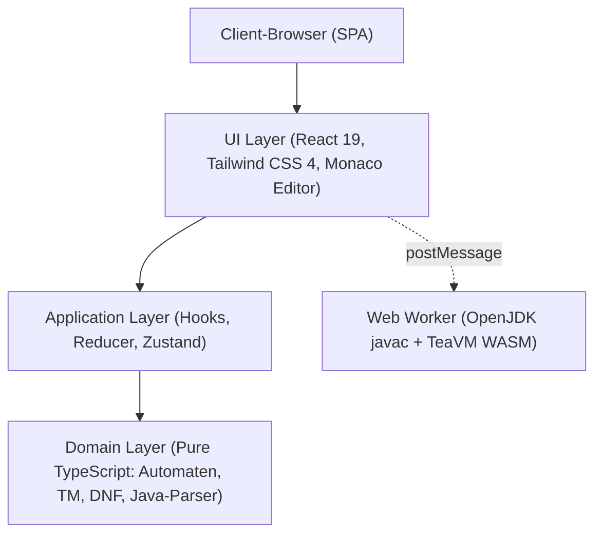

# Architektur der GI-Lernplattform

Kompakter Überblick über die Softwarearchitektur, Kernmuster und Designentscheidungen der Plattform.

---

## 1. Systemübersicht: Zero-Backend SPA

Die Lernplattform ist als **rein clientseitige Single-Page Application (SPA)** ohne Backend konzipiert:
* **Kein Server-Overhead:** Keine Datenbank, kein API-Server. Hosting erfolgt vollständig statisch (z. B. GitLab Pages, Nginx oder offline per lokalem Webserver).
* **Datenschutz & Persistenz:** Alle Eingaben, Zustände und Übungsfortschritte verbleiben im Browser (`localStorage`).
* **Client-Only Execution:** Simulationen, Algorithmen und selbst das Kompilieren von Java-Code laufen direkt im Browser des Nutzers.

---

## 2. Schichtenarchitektur im Modul

Jedes Fachmodul unter `app/src/pages/<Module>/<Topic>/` folgt einer klaren Schichtentrennung:

1. **Domänenschicht (`domain/`):**
   * Mathematische Kernlogik, Schrittfunktionen, Validierungen.
   * **Reines TypeScript**: Keine Abhängigkeiten zu React, DOM oder CSS. Vollständig unit-testbar via Vitest.
2. **Anwendungsschicht (`application/` bzw. Hooks):**
   * Kapselt Simulationssteuerung, Play/Step/Reset, Vor-/Zurück-Historie (`stepBack`) und Editorzustände.
3. **Präsentationsschicht (`components/`):**
   * React-Komponenten für die 4 Tabs, Tabellen, SVG-Zustandsgraphen und Steuerleisten.
4. **Isolierte Worker-Schicht (`javaRunner.worker.ts`):**
   * Kompiliert und führt Java-Code in einer WebAssembly-Sandbox aus.
   * Schützt den UI-Thread vor Blockaden; Endlosschleifen lassen sich per `worker.terminate()` sicher abbrechen.

---

## 3. Didaktisches Shared-Shell-Muster

Jedes Einzelthema bindet die geteilte Shell `ModuleTopicPage` ein und gliedert sich einheitlich in **vier Reiter**:

| Tab | Komponente | Zweck |
| :--- | :--- | :--- |
| **Übersicht** | `OverviewTab` | Theoretische Grundlagen, formale Definitionen und Begriffserklärungen. |
| **Beispiele** | `ExamplesTab` | Interaktive Beispielprogramme/Automaten mit Direktübernahme in die Simulation. |
| **Übungen** | `ExercisesTab` | Aufgaben mit automatisierten Validierungsprüfungen und didaktischem Feedback. |
| **Simulation** | `SimulationTab` | Interaktiver Arbeitsbereich (`SimulationWorkspace`) zum freien Experimentieren. |

---

## 4. Zentraler Modulkatalog (`moduleCatalog`)

Die Plattform steuert Navigation, Metadaten und Routen deklarativ über zwei Dateien:
* **`moduleCatalogData.ts` (Metadaten):** Reine Datenstruktur für Module, Pfade, Icons, Akzentfarben und Themen-IDs.
* **`moduleCatalog.tsx` (Routen & Lazy Loading):** Importiert die Themenseiten asynchron per `React.lazy()` und stellt das `learningRoutes`-Array für React Router bereit.
* **`topicStorageIds.ts`:** Eindeutige IDs für die isolierte Speicherung im `localStorage`.

---

## 5. State Management & i18n

* **Globaler State:** Minimal gehalten via Zustand (`uiStore.ts` für Navigation/Sidebar, `themeStore.ts` für Hell/Dunkel).
* **Fachlicher State:** Verbleibt lokal in den Custom Hooks der Module.
* **Mehrsprachigkeit:** `i18next` mit getrennten JSON-Dateien je Thema (`app/src/i18n/locales/{de,en}/<topic>.json`).
