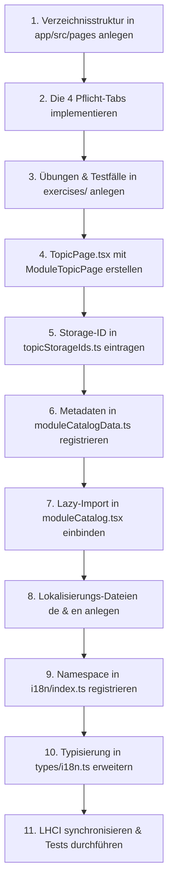

# Leitfaden: Neues Modul & Topic einbinden (Schritt-für-Schritt)

Dieses Dokument erklärt den vollständigen Prozess zur Integration eines neuen Fachbereichs (**Modul**) oder eines neuen Einzelthemas (**Topic**) in die GI-Lernplattform.

---

## 1. Begriffsdefinition: Modul vs. Topic

* **Modul (Fachbereich):** Die übergeordnete Lerneinheit (z. B. *Grundlagen Informatik* `/fundamentals-cs` oder *Programmieren 1* `/programming-1`). Ein Modul besitzt eine Überblicksseite und bündelt mehrere Topics.
* **Topic (Einzelthema):** Ein konkretes didaktisches Thema (z. B. *Turing-Maschine*, *Endliche Automaten*, *Zahlensysteme*). Ein Topic besitzt eine einheitliche 4-Tab-Struktur:
  1. `OverviewTab`: Theoretische Grundlagen & Begriffserklärungen
  2. `ExamplesTab`: Interaktiv ladbare Lehrbeispiele
  3. `ExercisesTab`: Übungen mit automatischer Validierung
  4. `SimulationTab`: Interaktive Sandbox / Simulator

---

## 2. Neues Topic (Thema) hinzufügen

Dies ist der häufigste Entwicklungsfall. Folgende 11 Schritte müssen der Reihe nach durchlaufen werden:



---

### Schritt 1: Verzeichnisstruktur erstellen

Erstellen Sie den Ordner für das neue Thema unter `app/src/pages/<ModuleName>/<TopicName>/`:

```text
app/src/pages/<ModuleName>/<TopicName>/
├── components/
│   ├── OverviewTab.tsx       # Theoretische Erklärung
│   ├── ExamplesTab.tsx       # Vorkonfigurierte Beispiele
│   ├── ExercisesTab.tsx      # Übungsübersicht & Starter
│   └── SimulationTab.tsx     # Die interaktive Werkbank
├── domain/                   # Reine TypeScript-Logik (Zustandsübergänge, Typen)
│   ├── types.ts
│   └── simulationCore.ts
├── application/              # Hooks für UI & State (optional falls komplex)
│   └── useTopicSimulation.ts
├── exercises/                # Aufgabenstellungen & Validierungslogik
│   └── index.ts
└── <TopicName>Page.tsx       # Haupteinstiegspunkt
```

---

### Schritt 2: Die 4 Tab-Komponenten implementieren

Jedes Tab ist eine eigenständige React-Komponente:

* **`OverviewTab.tsx`:** Didaktische Texte, Formeln, Diagramme und Markdown-Erklärungen.
* **`ExamplesTab.tsx`:** Liste von Lehrbeispielen. Beim Klick auf "Im Simulator öffnen" wird das Beispiel in den Simulator übertragen.
* **`ExercisesTab.tsx`:** Bindet den geteilten Übungs-Renderer ein (`ExerciseListView`) und übergibt die Liste der Aufgaben.
* **`SimulationTab.tsx`:** Beherbergt die eigentliche Visualisierung (SVG-Canvas, Editoren, Steuerungsleiste für Step/Play/Reset).

---

### Schritt 3: Aufgaben in `exercises/index.ts` definieren

Aufgaben werden strukturiert als Array exportiert:

```typescript
// app/src/pages/<ModuleName>/<TopicName>/exercises/index.ts
import type { TopicExercise } from "@/types/exercises";

export const topicExercises: TopicExercise[] = [
  {
    id: "ex-1",
    titleKey: "mein-thema.exercises.ex1.title",
    descriptionKey: "mein-thema.exercises.ex1.description",
    difficulty: "easy",
    starterData: { /* Startkonfiguration für den Simulator */ },
    validate: (userSolution) => {
      // Rückgabe: { passed: boolean, feedback: string, counterexample?: string }
      return { passed: true, feedback: "Korrekt gelöst!" };
    },
  },
];
```

---

### Schritt 4: Topic-Hauptseite erstellen (`<TopicName>Page.tsx`)

Verbinden Sie die Tabs über die vorgefertigte Komponente `ModuleTopicPage`:

```tsx
// app/src/pages/<ModuleName>/<TopicName>/<TopicName>Page.tsx
import { ModuleTopicPage } from "@/components/shared/ModuleTopicPage/ModuleTopicPage";
import { OverviewTab } from "./components/OverviewTab";
import { ExamplesTab } from "./components/ExamplesTab";
import { ExercisesTab } from "./components/ExercisesTab";
import { SimulationTab } from "./components/SimulationTab";

export function MeinThemaPage() {
  return (
    <ModuleTopicPage
      topicId="mein-thema"
      overviewTab={<OverviewTab />}
      examplesTab={<ExamplesTab />}
      exercisesTab={<ExercisesTab />}
      simulationTab={<SimulationTab />}
    />
  );
}
```

---

### Schritt 5: Eindeutige Storage-ID vergeben

Öffnen Sie `app/src/data/topicStorageIds.ts` und ergänzen Sie eine eindeutige numerische ID:

```typescript
export const TOPIC_STORAGE_IDS = {
  turingMachine: 1,
  finiteAutomata: 2,
  regularLanguages: 3,
  numberSystems: 4,
  mooreMealy: 5,
  dnf: 6,
  encoding: 7,
  javaProgramming: 8,
  meinThema: 9, // <-- NEU: Eindeutige ID für localStorage
} as const;
```

---

### Schritt 6: Metadaten im Katalog registrieren

Öffnen Sie `app/src/data/moduleCatalogData.ts` und fügen Sie das Topic in das passende Modul ein:

```typescript
import { Sparkles } from "lucide-react"; // Passendes Icon wählen

// Im jeweiligen Modul unter topics:
{
  id: "mein-thema",
  storageId: TOPIC_STORAGE_IDS.meinThema,
  titleKey: "mein-thema.title",
  descriptionKey: "mein-thema.description",
  path: "/fundamentals-cs/mein-thema",
  icon: Sparkles,
  accent: "purple", // "orange" | "blue" | "purple" | "green" | "rose"
  tutorialVideoUrl: "https://oc-stream.thws.de/.../mein-video.mp4",
}
```

---

### Schritt 7: Lazy-Loading-Komponente im Router registrieren

Öffnen Sie `app/src/data/moduleCatalog.tsx`:

1. Importieren Sie die Seite mit `lazy`:
```typescript
const MeinThemaTopicPage = lazy(async () => ({
  default: (await import("@/pages/FundamentalsCS/MeinThema/MeinThemaPage")).MeinThemaPage,
}));
```
2. Tragen Sie die Komponente in `topicPageElements` ein:
```typescript
const topicPageElements: Record<string, React.ReactElement> = {
  // ...
  "mein-thema": <MeinThemaTopicPage />,
};
```

> **Hinweis:** Da `learningRoutes` automatisch aus dem Katalog erzeugt wird, muss **keine** manuelle Route in `app/src/router/index.tsx` eingetragen werden!

---

### Schritt 8: Übersetzungsdateien anlegen

Legen Sie jeweils eine JSON-Datei für Deutsch und Englisch an:

* `app/src/i18n/locales/de/mein-thema.json`
* `app/src/i18n/locales/en/mein-thema.json`

Beispiel `de/mein-thema.json`:
```json
{
  "title": "Mein Neues Thema",
  "description": "Didaktische Einführung und interaktive Simulation.",
  "overview": { ... },
  "simulation": { ... },
  "exercises": { ... }
}
```

---

### Schritt 9: i18n-Namespace registrieren

Öffnen Sie `app/src/i18n/index.ts`:

```typescript
import deMeinThema from "./locales/de/mein-thema.json";
import enMeinThema from "./locales/en/mein-thema.json";

// In den i18n-Ressourcen-Objekten einhängen:
const resources = {
  de: {
    // ...
    "mein-thema": deMeinThema,
  },
  en: {
    // ...
    "mein-thema": enMeinThema,
  },
};
```

---

### Schritt 10: Typisierung der Translation-Keys aktualisieren

Öffnen Sie `app/src/types/i18n.ts` und stellen Sie sicher, dass die neuen Schlüssel in den Union-Typen (`TranslationKey`) aufgenommen werden, damit TypeScript Compile-Time-Sicherheit garantiert.

---

### Schritt 11: CI-Konfiguration abgleichen & Qualität prüfen

1. **Lighthouse CI aktualisieren:**
   ```bash
   npm run lhci:config
   ```
   *Dieses Skript übernimmt die neue Route automatisch in `lighthouserc.json`.*

2. **Tests & Linter prüfen:**
   ```bash
   npm run pre:commit:check
   ```
   *Führt TypeScript-Typecheck, ESLint, Prettier und den Produktions-Build durch.*

---

## 3. Komplett neues Modul (Hauptkategorie) hinzufügen

Falls ein völlig neues Obermodul (z. B. *Theoretische Informatik 2*) integriert werden soll:

### 1. Modul-Verzeichnis anlegen
`app/src/pages/<NeuesModul>/`

### 2. Modul-Übersichtsseite erstellen
Erstellen Sie `<NeuesModul>Page.tsx`:

```tsx
import { ModuleOverviewPage } from "@/components/shared/ModuleOverviewPage/ModuleOverviewPage";

export function NeuesModulPage() {
  return <ModuleOverviewPage moduleId="neues-modul" />;
}
```

### 3. Modul-Definition in `moduleCatalogData.ts` anlegen
Fügen Sie in `learningModules` ein neues Objekt ein:

```typescript
{
  id: "neues-modul",
  titleKey: "common.modules.neuesModul.title",
  descriptionKey: "common.modules.neuesModul.description",
  path: "/neues-modul",
  icon: Binary,
  topics: [], // Hier werden später die Topics eingehängt
}
```

### 4. Lazy-Import in `moduleCatalog.tsx` eintragen
```typescript
const NeuesModulPage = lazy(async () => ({
  default: (await import("@/pages/NeuesModul/NeuesModulPage")).NeuesModulPage,
}));

// In modulePageElements eintragen:
const modulePageElements: Record<string, React.ReactElement> = {
  // ...
  "neues-modul": <NeuesModulPage />,
};
```

### 5. Übersetzungen ergänzen
Fügen Sie `common.modules.neuesModul.title` und `.description` in:
* `app/src/i18n/locales/de/common.json`
* `app/src/i18n/locales/en/common.json`

Sobald das Modul registriert ist, erscheint es automatisch:
- in der Hauptnavigation auf der Startseite (`Home`),
- im Header-Menü,
- in der Sidebar-Navigation,
- im Breadcrumb-Pfad und im Router.
